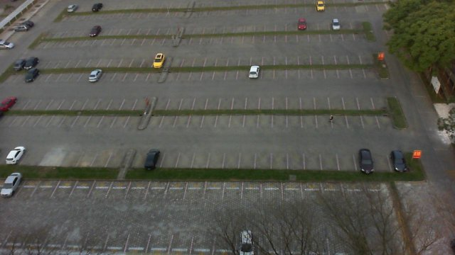
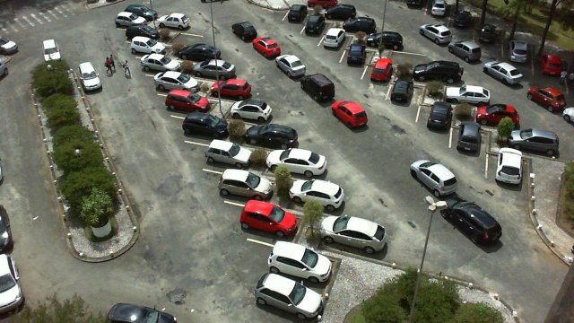
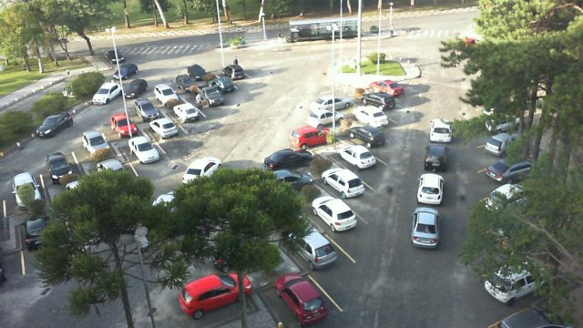

# Découpage par caméra : retrouver les caméras de PKLot

## Le problème

`src/data/prepare_split.py` répartit les images par **journée** : les 98 jours sont
mélangés puis coupés en train / valid / test. PKLot a pourtant été filmé par seulement
trois caméras fixes, donc chaque caméra apparaît dans les trois lots. Les scores publiés
(par exemple un rappel de 0,999 en validation) mesurent la performance sur des points de
vue **déjà vus à l'entraînement**, pas la généralisation à un parking nouveau. C'est ce que
confirme la démonstration : sur un parking jamais vu, le modèle ne détecte presque rien.

L'identifiant de caméra n'existe pas dans les données (les fichiers sont nommés par
horodatage seulement). Il fallait d'abord le retrouver.

## Méthode

[`src/data/cluster_cameras.py`](../src/data/cluster_cameras.py) regroupe les images sur leur
**arrière-plan**, puisqu'une caméra fixe donne un fond quasi identique :

1. chaque image des 12 142 images de `data/processed/split_manifest.csv` est lue en niveaux
   de gris et réduite à **64 x 36** ;
2. chaque vecteur est centré et normalisé, ce qui retire la luminosité (jour, nuit, soleil) ;
3. **k-means** avec k = 3 (les trois parkings de PKLot), initialisation k-means++, 10 départs,
   graine fixe : le résultat est identique à chaque exécution ;
4. **vote par jour** : un même jour est filmé par une seule caméra (vérifié, voir plus bas),
   donc chaque image reçoit le groupe majoritaire de sa journée.

Le k-means est écrit avec numpy seulement, sans scikit-learn.

## Résultat : trois groupes nets

Le fichier [`data/processed/camera_map.csv`](../data/processed/camera_map.csv) (colonnes
`image,cluster`) donne le groupe de chacune des 12 142 images. Un échantillon par groupe :

| Groupe 0 | Groupe 1 | Groupe 2 |
|---|---|---|
|  |  |  |

| Groupe | Images | Jours | Période | Places annotées par image | Parking probable |
|---|---|---|---|---|---|
| 0 | **4 473** | 37 | 2012-09-11 à 2012-11-20 | 100 | PUCPR (100 places) |
| 1 | **4 152** | 33 | 2013-02-22 à 2013-04-16 | 40 | UFPR05 (40 places) |
| 2 | **3 517** | 28 | 2012-12-07 à 2013-01-29 | 28 | UFPR04 (28 places) |

Les noms de parking sont une déduction à partir du nombre de places annotées (100, 40 et
28 places), pas une information lue dans les données.

### Contrôles

- **Les groupes correspondent aux parkings.** Le nombre de places annotées par image n'a
  **jamais servi** au regroupement. En le comparant ensuite : le k-means brut est d'accord
  avec lui sur 98,7 % des images, et après le vote par jour sur **100 %** (chaque groupe a un
  seul nombre de places : 100, 40 ou 28).
- **Un jour = une caméra.** Les 98 jours n'ont chacun qu'un seul nombre de places annotées,
  d'où le vote par jour. Il corrige 158 images (1,3 %), des images difficiles que le
  k-means place au mauvais groupe (cause non étudiée).
- **k = 3 est le bon nombre.** L'inertie baisse de 15,9 M (k = 2) à 12,7 M (k = 3), puis de
  seulement 4 % à k = 4 (12,2 M). Avec k = 4, le groupe supplémentaire ne correspond pas à
  une nouvelle caméra : il mélange des images des trois parkings (496 du 100 places, 152 du
  28 places, 141 du 40 places), donc il ne rassemble que les images difficiles.
  Il n'y a donc pas de caméra déplacée à fusionner à la main.
- **Les images d'exemple** ci-dessus montrent trois lieux visuellement distincts.

Le clustering sépare donc proprement les trois parkings : ce n'est pas un résultat négatif.

## Ce que cela révèle sur le découpage actuel

Répartition des trois caméras dans le découpage **par jour** actuel :

| Split actuel | Groupe 0 | Groupe 1 | Groupe 2 | Total |
|---|---|---|---|---|
| train | 3 118 | 2 475 | 3 020 | 8 613 |
| valid | 750 | 1 253 | 497 | 2 500 |
| test | 605 | 424 | 0 | 1 029 |

Les caméras des lots de validation et de test sont toutes aussi présentes dans
l'entraînement : les scores actuels ne mesurent pas la généralisation à un parking nouveau.
Le lot de test actuel (1 029 images) ne contient d'ailleurs que deux des trois caméras.

**Les groupes ont des périodes qui ne se recouvrent pas** (septembre à novembre 2012,
décembre 2012 à janvier 2013, février à avril 2013) : chaque parking a été filmé pendant
sa propre période. Un découpage par caméra est donc aussi un découpage dans le temps, et
on ne peut pas séparer les deux effets avec ces données.

## Le découpage par caméra

[`src/data/prepare_camera_split.py`](../src/data/prepare_camera_split.py) est un **nouveau**
script : il ne remplace pas `prepare_split.py`. Il tient à l'écart des caméras entières :

```powershell
python src/data/prepare_camera_split.py --train 0 --valid 2 --test 1
```

Il écrit `data/processed/camera_split_manifest.csv` (colonnes `image,date,cluster,split`,
ignoré par Git comme `split_manifest.csv`, car recalculable). Affectation par défaut :

| Split | Groupe | Images | Jours |
|---|---|---|---|
| train | 0 (100 places) | 4 473 | 37 |
| valid | 2 (28 places) | 3 517 | 28 |
| test | 1 (40 places) | 4 152 | 33 |

Ce qui reste **inchangé** : `data/processed/split_manifest.csv`, `data/processed/yolo/`, la
liste de test `data/processed/yolo/test.txt` (1 029 images réservées à l'évaluation finale),
`configs/evaluation_protocol.yaml` et le modèle champion. Les résultats publiés restent
reproductibles.

### Limites

- **L'entraînement ne voit qu'une seule caméra** (le groupe 0). Avec trois caméras, c'est
  la seule façon de garder un groupe entier pour la validation et un autre pour le test.
  Les chiffres obtenus avec ce découpage seront très inférieurs à ceux de l'expérience B :
  cet écart est le résultat, il mesure l'écart de généralisation.
- **D'autres affectations sont possibles** avec `--train`, `--valid` et `--test` (par
  exemple tester successivement chaque caméra).
- **Aucun réentraînement n'a été fait** : cette tâche livre la carte des caméras et le
  découpage, pas de nouveaux scores.
- Le groupe 0 est le plus grand et se prête mieux à l'entraînement, mais ses 100 places
  par image le distinguent des deux autres parkings, de 28 et 40 places.

## Reproduire

```powershell
python src/data/cluster_cameras.py --k 3 --per-cluster 1 --samples reports/camera_split/samples
python src/data/prepare_camera_split.py
```

Les données doivent être présentes (`dvc pull -r dagshub`). Le premier script lit les
12 142 images (environ 25 secondes), affiche les contrôles ci-dessus et réécrit
`data/processed/camera_map.csv`. Il n'a pas besoin de GPU ni de scikit-learn.
Tests : `tests/test_camera_split.py` (images synthétiques).
