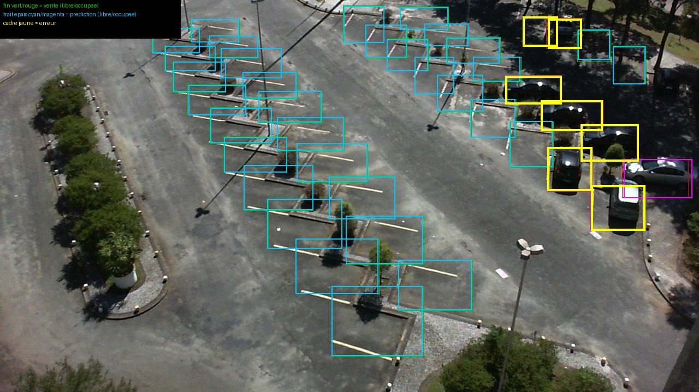
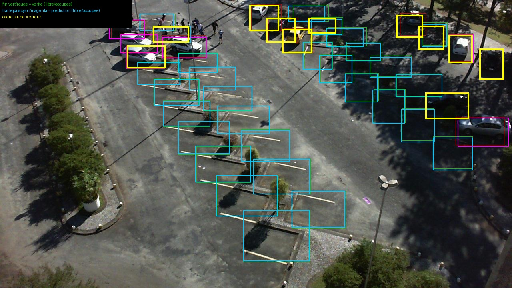
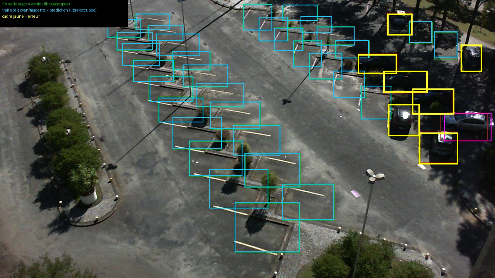

# ParkVision — Expérience C : détection et comptage avec YOLO26n

## 1. Introduction

ParkVision vise à détecter les places de stationnement visibles dans une image et à déterminer leur état : **libre** (`space-empty`) ou **occupée** (`space-occupied`). Le nombre de détections de chaque classe fournit ensuite une estimation du nombre de places libres et occupées. Le problème associe donc deux objectifs liés mais distincts : localiser et classifier chaque place, puis produire un comptage fiable par image.

Les expériences du projet suivent un protocole commun afin d'étudier l'effet du modèle :

- **expérience A** : modèle de référence YOLOv8n ;
- **expérience B** : YOLOv8s, plus capacitaire, avec les mêmes données et hyperparamètres principaux ;
- **expérience C** : YOLO26n, évalué dans ce rapport.

L'expérience C change bien de famille d'architecture par rapport aux expériences A et B. En revanche, aucun document suivi par Git ne définit une ancienne architecture ou un objectif initial différent pour C. Il n'est donc pas possible d'affirmer, sur la seule base du dépôt, que le choix de YOLO26n a remplacé un objectif C antérieur. La configuration effectivement entraînée est sans ambiguïté : `configs/train_c.yaml` utilise `yolo26n.pt`.

Ce rapport repose uniquement sur le lot de validation. Les 1 029 images de test restent réservées à l'évaluation finale, après sélection du modèle et du protocole.

## 2. Jeu de données et prétraitement

### 2.1 PKLot et organisation brute

Le projet utilise PKLot, ici préparé pour une détection à deux classes :

| Identifiant | Classe | Interprétation |
|---:|---|---|
| 0 | `space-empty` | place libre |
| 1 | `space-occupied` | place occupée |

Les données brutes sont organisées dans `data/raw/{train,valid,test}/`, chaque ancien lot contenant un dossier `images/` et un dossier `labels/`. Les annotations suivent le format YOLO : une ligne par objet, avec la classe et les coordonnées normalisées du cadre englobant. Cette ancienne organisation n'est pas utilisée directement pour l'entraînement final : un nouveau découpage reproductible est construit à partir des dates de prise de vue.

La provenance DVC de `data/raw` est enregistrée dans `data/raw.dvc` : empreinte de répertoire MD5 `7ebd4f8ce4ef27bdc80d05e92882a012.dir`, taille 1 817 499 248 octets et 24 835 fichiers. Le verrou `dvc.lock` reprend la même empreinte pour les étapes de préparation.

### 2.2 Construction du découpage

L'étape `prepare_split` (`src/data/prepare_split.py`) :

1. parcourt les annotations des trois anciens lots ;
2. écarte les annotations vides ;
3. extrait la date depuis le nom de fichier ;
4. mélange la liste des journées avec la graine 42 ;
5. affecte environ 70 % des journées à l'entraînement, 20 % à la validation et 10 % au test ;
6. écrit `data/processed/split_manifest.csv`.

Les effectifs vérifiés dans le manifeste sont :

| Lot | Journées distinctes | Images | Part des 12 142 images retenues |
|---|---:|---:|---:|
| Entraînement | 69 | 8 613 | 70,9 % |
| Validation | 19 | 2 500 | 20,6 % |
| Test | 10 | 1 029 | 8,5 % |
| **Total** | **98** | **12 142** | **100 %** |

La séparation par journée empêche qu'une même journée de capture apparaisse dans plusieurs lots. Elle réduit une fuite de données importante : deux images proches dans le temps, provenant d'une même séquence et présentant presque la même scène, ne doivent pas être réparties entre entraînement et validation. Cette précaution ne sépare toutefois pas nécessairement les parkings ou les caméras ; elle ne suffit donc pas à démontrer une généralisation à un site inconnu.

### 2.3 Conversion vers le format d'entraînement

L'étape `prepare_yolo` (`src/data/prepare_yolo.py`) relit le manifeste, vérifie l'unicité des images, l'exclusivité des journées, la présence des images et annotations ainsi que l'absence d'annotations vides. Elle produit :

- `data/processed/yolo/train.txt` ;
- `data/processed/yolo/valid.txt` ;
- `data/processed/yolo/test.txt` ;
- `data/processed/yolo/data.yaml` avec les deux classes attendues.

Avant l'entraînement, `src/models/train.py` recoupe ces listes avec le manifeste, refuse les doublons et vérifie que les images train/validation et leurs annotations existent. Les images de test ne sont pas copiées dans le dossier d'exécution. L'empreinte SHA-256 vérifiée du manifeste est :

```text
b51c7072a9276eff8c69d9023849979efaecf1aadd458f31c2e81651ee76630a
```

## 3. Méthodologie expérimentale

### 3.1 Modèle et apprentissage par transfert

YOLO26n est la variante « nano » de YOLO26. Le fichier `yolo26n.pt` fournit des poids préentraînés (`pretrained: true` dans `args.yaml`) qui sont adaptés aux deux classes de ParkVision. Il s'agit donc d'un apprentissage par transfert et non d'un entraînement depuis une initialisation aléatoire.

YOLO26 dispose d'une tête one-to-many avec NMS et d'une tête one-to-one permettant une inférence end-to-end sans NMS. Dans ce run, `nms: null` conserve le chemin one-to-many par défaut ; la NMS et son seuil IoU restent donc actifs. Un déploiement réellement NMS-free demanderait explicitement `nms=False`. Cette distinction est importante : le présent rapport évalue la configuration exécutée, pas toutes les variantes d'inférence possibles de YOLO26.

### 3.2 Paramètres effectifs

Les valeurs suivantes proviennent de `configs/train_c.yaml` et du fichier effectif `runs/detect/C_yolo26n_a43e67dc/args.yaml` :

| Paramètre | Valeur |
|---|---|
| Modèle initial | `yolo26n.pt` |
| Époques maximales | 50 |
| Patience | 10 |
| Taille d'image | 640 × 640 |
| Batch | 16 |
| Optimiseur | AdamW |
| Taux initial `lr0` | 0,001 |
| Facteur final `lrf` | 0,01 |
| Momentum | 0,937 |
| Décroissance des poids | 0,0005 |
| Warm-up | 3 époques |
| Graine | 42 |
| Mode déterministe | activé |
| AMP | activé |
| Cache | désactivé |
| Workers | 2 |
| GPU | NVIDIA GeForce RTX 4060 Laptop GPU, périphérique 0, 8 188 MiB de VRAM |

Les augmentations enregistrées comprennent notamment les variations HSV (`hsv_h=0,015`, `hsv_s=0,7`, `hsv_v=0,4`), la translation (`0,1`), le changement d'échelle (`0,5`), le retournement horizontal (`0,5`) et Mosaic (`1,0`). Les rotations, cisaillements, perspectives, retournements verticaux, MixUp, CutMix et Copy-Paste sont désactivés. `close_mosaic: 10` désactive Mosaic pendant les dix dernières époques.

### 3.3 Traçabilité Git, DVC et MLflow

- **Git** identifie le code exécuté et la branche. Le run MLflow enregistre le commit et l'empreinte du script d'entraînement.
- **DVC** décrit la provenance des données brutes et les deux étapes déterministes de préparation dans `dvc.yaml` et `dvc.lock`.
- **MLflow** conserve les paramètres effectifs, l'historique par époque, les métriques finales, l'environnement logiciel, les artefacts d'entraînement et les tags de provenance.

Le run source MLflow est `a43e67dc22424bb6842532de9ee5bcb7`, nommé `C_yolo26n` dans l'expérience `ParkVision`. Son tag `test_evaluated` vaut `false`.

### 3.4 Essai court et entraînement complet

Le mode `--smoke` vérifie la chaîne complète sur une époque, 128 images d'entraînement et 32 images de validation sélectionnées avec la graine du projet. Pour cet essai seulement, la patience, le warm-up et `close_mosaic` sont mis à zéro. Le run d'essai C est distinct (`10c25b0be7bf41bda00c594d09aad26f`) et ses métriques ne servent pas à comparer les modèles.

L'entraînement complet repart ensuite de `yolo26n.pt` sur les 8 613 images d'entraînement et valide à chaque époque sur les 2 500 images du lot `valid`. Ultralytics enregistre `last.pt` et le meilleur point de contrôle `best.pt`. Pour ce run, la métrique MLflow `best_val/fitness` vaut `0,918610` et coïncide avec le mAP50-95 de la validation finale ; l'époque 49 présente le plus grand mAP50-95 de l'historique (`0,91867`).

## 4. Résultats d'entraînement

### 4.1 Durée et métriques globales

Les 50 époques ont été terminées ; l'arrêt anticipé ne s'est pas déclenché. Le temps cumulé contenu dans `results.csv` est de 6 967,03 s, soit **1,936 h**. La durée totale MLflow est de 7 055,11 s, soit environ 1,960 h, car elle inclut aussi les opérations entourant l'entraînement et la validation finale.

La réévaluation du meilleur point de contrôle, enregistrée dans MLflow, donne :

| Indicateur | Valeur exacte enregistrée | Valeur arrondie |
|---|---:|---:|
| Précision | 0,997917 | 0,998 |
| Rappel | 0,997860 | 0,998 |
| mAP50 | 0,994837 | 0,995 |
| mAP50-95 | 0,918610 | 0,919 |

La validation contient 2 500 images et 139 036 instances. Les résultats par classe communiqués avec la validation sont :

| Classe | Instances | mAP50-95 |
|---|---:|---:|
| `space-empty` | 73 367 | 0,936 |
| `space-occupied` | 65 669 | 0,901 |

Les effectifs par classe sont vérifiés dans les artefacts de comptage et leur somme vaut bien 139 036. En revanche, le run local ne contient pas de fichier texte ou JSON persistant avec le détail complet précision/rappel/mAP par classe ; les deux mAP50-95 par classe ci-dessus restent donc à confirmer depuis la sortie originale de validation ou par une réévaluation contrôlée sur `valid`. Aucune réévaluation n'a été lancée pour rédiger ce rapport.

### 4.2 Évolution des pertes et convergence

| Époque | train box | train cls | train L1 | val box | val cls | val L1 | mAP50-95 |
|---:|---:|---:|---:|---:|---:|---:|---:|
| 1 | 1,5935 | 1,23131 | 0,00380 | 1,25160 | 0,68491 | 0,00494 | 0,65116 |
| 20 | 0,59916 | 0,21206 | 0,00119 | 0,47484 | 0,15350 | 0,00176 | 0,89574 |
| 40 | 0,48929 | 0,17215 | 0,00095 | 0,43736 | 0,13954 | 0,00161 | 0,91018 |
| 41 | 0,40132 | 0,13582 | 0,00092 | 0,43912 | 0,14282 | 0,00164 | 0,91237 |
| 49 | 0,34412 | 0,11827 | 0,00077 | 0,41652 | 0,13618 | 0,00154 | **0,91867** |
| 50 | 0,34308 | 0,11834 | 0,00076 | 0,41747 | 0,13757 | 0,00155 | 0,91827 |

Les pertes d'entraînement et de validation diminuent fortement au début, puis plus progressivement. Le mAP50 atteint 0,994 dès l'époque 3 et devient rapidement peu discriminant. Le mAP50-95, plus exigeant sur la localisation, progresse encore de 0,651 à 0,919 environ. Les pertes de validation restent globalement stables ou décroissantes en fin d'entraînement, sans divergence nette indiquant un surapprentissage majeur sur ce lot.

La rupture visible entre les époques 40 et 41 concerne surtout les pertes d'entraînement : la box loss passe de 0,48929 à 0,40132 et la classification loss de 0,17215 à 0,13582. `close_mosaic: 10` signifie que Mosaic est désactivé pour les dix dernières époques, donc à partir de l'époque 41 dans un entraînement de 50 époques. La coïncidence temporelle rend cette explication plausible : les images non composées constituent un problème d'entraînement plus proche des images naturelles et peuvent produire des pertes d'une autre échelle. Elle ne prouve toutefois pas à elle seule une causalité ; les pertes continuent aussi d'évoluer avec le taux d'apprentissage.


## 5. Analyse des erreurs de détection et de comptage

### 5.1 Protocole d'inférence et d'appariement

L'analyse personnalisée est produite par `src/analysis/analyze_errors.py` sur les 2 500 images `valid` du manifeste :

| Paramètre | Valeur |
|---|---:|
| Seuil de confiance | 0,25 |
| Taille d'inférence | 640 |
| IoU de post-traitement NMS | 0,7 |
| IoU minimal d'appariement | 0,5 |
| Batch | 16 par défaut |

Le script appelle `model.predict(..., conf=0.25, iou=0.7)` sans imposer `nms=False`. Avec `nms: null` pour YOLO26, Ultralytics utilise le chemin one-to-many et applique la NMS standard ; le seuil 0,7 est donc pertinent. Une future évaluation de la tête one-to-one NMS-free constituerait un protocole différent et devrait être identifiée séparément.

L'appariement personnalisé trie toutes les paires annotation-prédiction par IoU décroissant. Il apparie d'abord les cadres de même classe, puis classe les autres événements en confusion, oubli, double détection ou fausse détection. Le seuil d'appariement est fixé à 0,5.

### 5.2 Qualité du comptage

Pour une image (i), une classe (c) et (N=2\,500) images, la MAE utilisée est :

\[
\operatorname{MAE}_c = \frac{1}{N}\sum_{i=1}^{N}\left|\hat n_{i,c}-n_{i,c}\right|.
\]

| Indicateur | Places libres | Places occupées |
|---|---:|---:|
| Total annoté | 73 367 | 65 669 |
| Total prédit | 74 004 | 65 799 |
| Écart signé | **+637** (+0,87 %) | **+130** (+0,20 %) |
| MAE par image | **0,2652** | **0,1496** |
| Images au comptage exact | 2 089 / 2 500 (**83,56 %**) | 2 189 / 2 500 (**87,56 %**) |

Les deux comptages sont simultanément exacts pour **1 903 images sur 2 500, soit 76,12 %**.

Le modèle surestime donc les deux classes à l'échelle du lot. L'écart cumulé est de 767 détections supplémentaires, soit environ 0,31 détection par image. Cet écart signé ne remplace pas la MAE : des surestimations et sous-estimations peuvent se compenser entre images.

### 5.3 Événements d'erreur

| Type d'erreur | Nombre | Définition opérationnelle |
|---|---:|---|
| Fausse détection | 753 | prédiction sans annotation appariée |
| Confusion | 156 | emplacement apparié, classe incorrecte |
| Double détection | 54 | prédiction supplémentaire sur une place déjà appariée |
| Oubli | 40 | annotation sans prédiction appariée |
| **Total** | **1 003** | — |

Le bilan total est cohérent avec le comptage : 753 fausses détections + 54 doubles − 40 oublis = **+767 objets prédits**. Les 156 confusions déplacent un objet entre les deux classes sans changer le nombre total d'objets. Cette égalité vérifie la cohérence arithmétique entre `comptage.csv`, `comptage_resume.json` et `erreurs_detail.csv` ; elle ne garantit pas que chaque catégorie corresponde à une erreur visuelle réelle, car une place visible mais absente de l'annotation peut être classée comme fausse détection.

Les exemples suivants ont été inspectés. Les traits fins verts/rouges représentent les annotations libre/occupée, les traits épais cyan/magenta les prédictions et les cadres jaunes les événements signalés. Les scènes montrent que plusieurs erreurs se concentrent dans des zones ombragées ou encombrées ; cette observation locale ne suffit pas à conclure que l'ombre est la cause générale des erreurs.

| Fausse détection | Confusion | Plus grand écart de comptage sélectionné |
|---|---|---|
|  |  |  |

### 5.4 Différence avec l'évaluation mAP Ultralytics

Les deux évaluations répondent à des questions différentes :

- Ultralytics calcule les courbes précision-rappel sur une plage de seuils de confiance et le mAP50-95 moyenne l'AP pour plusieurs seuils IoU de 0,50 à 0,95 ;
- l'analyse personnalisée fige la confiance à 0,25, la NMS à 0,7 et l'appariement à IoU 0,5, puis compte des événements discrets et des erreurs de comptage par image.

Un mAP très élevé peut donc coexister avec un taux de comptage exact plus faible. Quelques prédictions supplémentaires par image ont peu d'effet sur une courbe globale dominée par 139 036 instances, mais suffisent à rendre le comptage d'une image inexact.

## 6. Discussion

### 6.1 Forces observées

YOLO26n atteint une précision et un rappel proches de 0,998, un mAP50 de 0,995 et un mAP50-95 de 0,919. La faible différence entre précision et rappel montre un comportement globalement équilibré. Malgré sa taille « nano », le modèle localise correctement la grande majorité des 139 036 places de validation et termine l'entraînement en moins de deux heures sur le GPU utilisé.

Le mAP50-95 de `space-empty` communiqué (0,936) dépasse celui de `space-occupied` (0,901). Cette différence suggère une localisation plus précise des places libres dans ce protocole, mais elle ne suffit pas à identifier sa cause.

### 6.2 Surestimation et fausses détections

La faiblesse principale observée est la surestimation : +637 places libres et +130 places occupées. Les 753 fausses détections représentent 75,1 % des 1 003 événements d'erreur, loin devant les oublis. Plusieurs explications sont possibles — annotations incomplètes, motifs de sol ressemblant à des places, ombres, véhicules ou perspective — mais elles restent des hypothèses tant qu'un échantillon représentatif des 753 événements n'est pas relu visuellement.

Le nombre de détections fausses ou dupliquées explique pourquoi les performances de localisation agrégées restent excellentes alors que seuls 76,12 % des images ont simultanément les deux comptes exacts. La métrique d'exploitation doit donc inclure le comptage, et pas seulement le mAP.

### 6.3 Limites de généralisation

La validation mesure la généralisation à des journées non vues, pas nécessairement à des caméras, parkings ou distributions d'éclairage inconnus. Des vues proches peuvent partager la géométrie de scène, le marquage au sol et l'angle de caméra entre les lots. Les résultats ne démontrent donc pas encore la robustesse à une nouvelle installation, à une photo prise à main levée, à la nuit, à la pluie ou à des conditions météorologiques absentes de PKLot.

## 7. Comparaison avec les expériences A et B

Les comparaisons suivantes utilisent seulement des résultats dont le protocole est identifiable. L'expérience B partage avec C les 2 500 images de validation, la confiance 0,25, la NMS IoU 0,7, l'appariement IoU 0,5 et la taille 640. Les matériels diffèrent toutefois : Tesla T4 pour B et RTX 4060 Laptop pour C ; la durée et la vitesse ne doivent donc pas servir à classer les architectures.

Le notebook de l'expérience A contient une exécution interrompue pendant l'époque 30/50, sans validation finale du meilleur point de contrôle ni analyse de comptage suivie dans le dépôt. Ses valeurs intermédiaires ne sont pas comparables à des runs complets et ne sont pas utilisées pour classer les modèles.

| Indicateur sur validation | A — YOLOv8n | B — YOLOv8s | C — YOLO26n |
|---|---:|---:|---:|
| Run complet vérifié | non | oui | oui |
| Précision | indisponible | 0,999 | 0,998 |
| Rappel | indisponible | 0,999 | 0,998 |
| mAP50 | indisponible | 0,995 | 0,995 |
| mAP50-95 | indisponible | **0,933** | 0,919 |
| MAE libres | indisponible | **0,0784** | 0,2652 |
| MAE occupées | indisponible | **0,0620** | 0,1496 |
| Deux comptes exacts | indisponible | **2 294/2 500 (91,8 %)** | 1 903/2 500 (76,12 %) |
| Oublis | indisponible | 40 | 40 |
| Fausses détections | indisponible | **196** | 753 |
| Doubles détections | indisponible | **23** | 54 |
| Confusions | indisponible | **88** | 156 |

Sur ce protocole de validation, YOLOv8s (B) obtient un meilleur mAP50-95, des MAE plus faibles et davantage d'images au comptage exact que YOLO26n (C). Il serait donc incorrect de déclarer YOLO26n meilleur sur la base des résultats disponibles. Ce constat ne compare ni la taille mémoire, ni la latence sur un matériel commun, ni le mode NMS-free optionnel de YOLO26n.

## 8. Conclusion et prochaines étapes

L'expérience C a entraîné YOLO26n pendant 50 époques sur 8 613 images et l'a sélectionné sur 2 500 images de validation. Le meilleur point de contrôle atteint un mAP50-95 de 0,919 environ, avec une précision et un rappel proches de 0,998. Le modèle reste néanmoins moins fiable pour un comptage exact : MAE de 0,2652 pour les places libres, 0,1496 pour les places occupées et exactitude conjointe de 76,12 %. Les 753 fausses détections dominent l'analyse et produisent une surestimation totale de 767 objets.

Les prochaines étapes recommandées sont :

1. relire un échantillon stratifié des fausses détections, confusions et doubles détections, en distinguant les erreurs du modèle des annotations absentes ou décalées ;
2. confirmer dans un artefact persistant les métriques par classe de C ;
3. produire ou récupérer un run A complet avant toute comparaison A/B/C définitive ;
4. comparer B et C sur le même matériel, avec les mêmes lots, seuils et mesures de latence ;
5. évaluer séparément, si utile au déploiement, la tête NMS-free de YOLO26n ;
6. tester la robustesse sur des caméras, parkings et conditions lumineuses réellement nouveaux.

Le lot test ne doit être évalué qu'une seule fois, après la sélection définitive du modèle, du mode d'inférence et des seuils. Il n'a pas été utilisé pour cette analyse.

## 9. Reproductibilité

### 9.1 Identifiants et empreintes

| Élément | Valeur |
|---|---|
| Branche | `experience-c-yolo26n` |
| Commit Git enregistré | `4c9d8c7fa696b7a99b3aece911d4276f868c2995` |
| Run MLflow source | `a43e67dc22424bb6842532de9ee5bcb7` |
| Nom du run | `C_yolo26n` |
| Modèle initial | `yolo26n.pt` |
| Point de contrôle évalué | `runs/detect/C_yolo26n_a43e67dc/weights/best.pt` |
| SHA-256 de `best.pt` | `efde509277dc0ea69f3077356c81b86839bd3caf19343ce58ca562fbe097c69a` |
| Taille de `best.pt` | 5 429 509 octets |
| SHA-256 du manifeste | `b51c7072a9276eff8c69d9023849979efaecf1aadd458f31c2e81651ee76630a` |
| SHA-256 du script d'entraînement enregistré | `64d103f9f6831e4b32cf71600342b8c268ee1b4fce157ff403bb67b08e4d0018` |

### 9.2 Environnement enregistré

| Composant | Version ou valeur |
|---|---|
| Python | 3.13.12 |
| PyTorch | 2.11.0+cu128 |
| Ultralytics | 8.4.201 |
| MLflow | 3.17.2 |
| CUDA PyTorch | 12.8 |
| GPU | NVIDIA GeForce RTX 4060 Laptop GPU, 8 188 MiB de VRAM |

Ces valeurs proviennent de `tracking/artifacts/a43e67dc22424bb6842532de9ee5bcb7/artifacts/provenance/environment.json`. Le fichier `requirements-training.txt` fixe Ultralytics 8.4.201, MLflow 3.17.2, DVC 3.67.1 et PyYAML 6.0.3 ; PyTorch et CUDA dépendent de l'environnement d'exécution.

### 9.3 Commandes de reproduction

Depuis la racine du dépôt, après récupération des données DVC :

```powershell
# Reproduire le manifeste et les listes YOLO.
dvc repro

# Vérifier la configuration, les fichiers et l'exclusivité des journées,
# sans charger le GPU et sans entraîner.
python src/models/train.py --config configs/train_c.yaml --check

# Vérification courte de la chaîne GPU (métriques non comparatives).
python src/models/train.py --config configs/train_c.yaml --smoke

# Entraînement complet.
python src/models/train.py --config configs/train_c.yaml
```

Après entraînement et sélection de `best.pt`, reproduire l'analyse sur **validation uniquement** :

```powershell
python src/analysis/analyze_errors.py `
  --weights runs/detect/C_yolo26n_a43e67dc/weights/best.pt `
  --manifest data/processed/split_manifest.csv `
  --output reports/experience_c/validation `
  --conf 0.25 `
  --nms-iou 0.7 `
  --imgsz 640 `
  --batch 16 `
  --device 0
```

Le nom du dossier d'entraînement contient les huit premiers caractères du run MLflow et varie donc pour une nouvelle exécution. La graine et le mode déterministe améliorent la répétabilité, sans garantir une identité bit à bit entre matériels, pilotes ou versions de bibliothèques.

### 9.4 Artefacts utiles

- configuration effective : `runs/detect/C_yolo26n_a43e67dc/args.yaml` ;
- historique par époque : `runs/detect/C_yolo26n_a43e67dc/results.csv` ;
- courbes : `runs/detect/C_yolo26n_a43e67dc/results.png` ;
- poids : `runs/detect/C_yolo26n_a43e67dc/weights/{best,last}.pt` ;
- comptage par image : `reports/experience_c/validation/comptage.csv` ;
- synthèse : `reports/experience_c/validation/comptage_resume.json` ;
- événements : `reports/experience_c/validation/erreurs_detail.csv` ;
- exemples annotés : `reports/experience_c/validation/exemples/` ;
- provenance MLflow : `tracking/artifacts/a43e67dc22424bb6842532de9ee5bcb7/artifacts/provenance/`.

## Sources techniques du dépôt

- `dvc.yaml`, `dvc.lock`, `data/raw.dvc` et `data/processed/split_manifest.csv` pour la provenance et le découpage ;
- `src/data/prepare_split.py` et `src/data/prepare_yolo.py` pour le prétraitement ;
- `configs/train_c.yaml`, `src/models/train.py` et `args.yaml` pour le protocole ;
- `results.csv` et les métriques MLflow pour l'entraînement ;
- `src/analysis/analyze_errors.py` et les fichiers de `reports/experience_c/validation/` pour le comptage et les erreurs ;
- [documentation officielle Ultralytics sur l'inférence end-to-end de YOLO26](https://docs.ultralytics.com/guides/end2end-detection) pour la distinction entre les chemins NMS et NMS-free.
