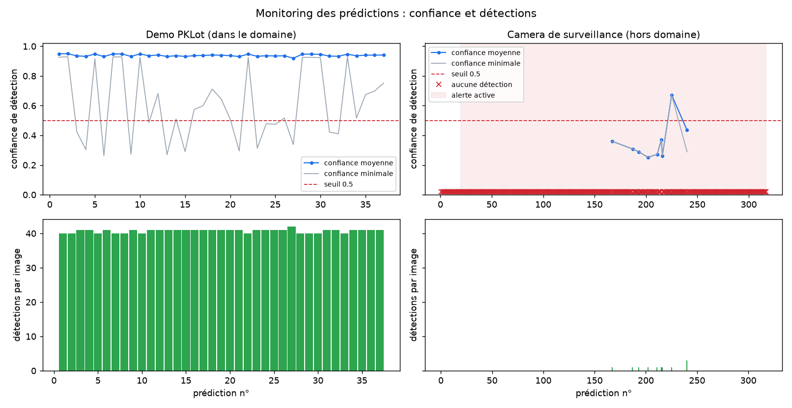

# Monitoring des prédictions

Jusqu'ici, le service ne gardait aucune trace de ses prédictions : pas d'historique, pas
d'agrégat, aucun signal quand le modèle se comporte mal. Ce document décrit le monitoring
ajouté, **désactivé par défaut**, et la preuve qu'il distingue une vidéo du domaine
d'entraînement d'une vidéo hors domaine.

Il respecte les règles du service : accès local uniquement, aucune base de données,
aucune écriture dans le registre, fichiers bornés. L'ancien tableau de bord serveur n'est
pas réintroduit (`tests/test_dashboard.py` le vérifie toujours).

## Ce qui est enregistré

Une ligne JSON par prédiction (format JSONL), ajoutée à un fichier local :

| Champ | Contenu |
|---|---|
| `ts` | horodatage UTC |
| `route` | `/predict`, `/predict/visualize` ou `video_frame` (image d'une vidéo) |
| `model_version` | version du champion qui a répondu |
| `error` | `true` si l'inférence a échoué (les champs suivants sont alors `null`) |
| `empty`, `occupied`, `total` | nombre de places détectées par classe, et au total |
| `conf_mean`, `conf_min` | confiance moyenne et minimale des détections (`null` s'il n'y en a aucune) |
| `inference_ms` | durée de l'inférence |

**L'image n'est jamais enregistrée**, ni son nom ni son chemin. Exemple de ligne :

```json
{"ts":"2026-11-28T11:46:22.938+00:00","route":"video_frame","model_version":"2","error":false,"empty":39,"occupied":1,"total":40,"conf_mean":0.9499,"conf_min":0.9262,"inference_ms":123.039}
```

## Activer le monitoring

Trois variables d'environnement, dans le style des autres options (`src/api/config.py`,
valeurs vérifiées strictement) :

| Variable | Défaut | Rôle |
|---|---|---|
| `PARKVISION_MONITORING_ENABLED` | `false` | `true` ou `false` : active le journal |
| `PARKVISION_MONITORING_LOG` | `~/.parkvision/monitoring/predictions.jsonl` | fichier du journal |
| `PARKVISION_MONITORING_MAX_BYTES` | `5242880` (5 Mo) | taille maximale avant rotation (minimum 1024) |

Désactivé, **rien n'est écrit et le comportement de l'API ne change pas** (test dédié).
Activé, une erreur d'écriture est loggée une fois et n'affecte jamais une prédiction.

**Le journal est borné** : quand il atteindrait la taille maximale, il est renommé en
`<nom>.jsonl.1` (en remplaçant l'ancienne rotation) et un nouveau fichier commence. Le
total ne dépasse donc jamais deux fois la limite, soit 10 Mo par défaut.

```powershell
$env:PARKVISION_MONITORING_ENABLED = "true"
python -m uvicorn src.api.main:app --host 127.0.0.1 --port 8000 --workers 1
```

## Lire le journal : rapport et alertes

```bash
python src/analysis/monitor_report.py journal.jsonl [autre.jsonl ...] [--plot courbe.png]
```

Pour chaque journal, le rapport donne : nombre de requêtes, taux d'erreur, latence médiane
et p95, confiance moyenne, détections par image et part de requêtes sans détection. Le
script est en lecture seule. Son code de sortie est **2 si une alerte s'est déclenchée**,
0 sinon. Avec `--plot`, il trace la confiance et le nombre de détections dans le temps,
un panneau par journal.

### Les deux règles d'alerte

Elles s'évaluent sur une **fenêtre glissante des 20 dernières prédictions réussies**
(avant 20 prédictions, elles ne sont pas évaluables). Elles signifient la même chose en
pratique : l'entrée est probablement hors de la distribution d'entraînement.

| # | Règle | Condition | Seuil |
|---|---|---|---|
| 1 | `confiance_basse` | confiance moyenne des détections de la fenêtre | **< 0,5** |
| 2 | `resultats_vides` | part des requêtes de la fenêtre sans aucune détection | **> 50 %** |

Les seuils sont ceux de l'exemple de la passation, ajustables avec `--confidence-threshold`,
`--empty-threshold` et `--window`. Ils n'ont pas été réglés pour obtenir un bon résultat :
l'écart entre les deux vidéos ci-dessous est tel qu'ils auraient pu être très différents.
Les deux règles se complètent : si le modèle ne détecte plus rien, il n'y a plus de
confiance à mesurer et seule la règle 2 peut se déclencher.

## Preuve : la vidéo de démo ne déclenche rien, la vidéo hors domaine si

Deux vidéos rejouées dans la vraie API (champion version 2, monitoring activé, un journal
par vidéo) :

- **Dans le domaine** : `reports/demo/demo_2013-03-15.mp4`, la journée du 15 mars 2013 du
  lot test PKLot (parking de 40 places, 36 s).
- **Hors domaine** : une vidéo de caméra de surveillance d'un autre parking
  (« BLK-HDPTZ12 Security Camera Parkng Lot Surveillance Video.mp4 », 640 x 360, 316 s),
  fournie par l'équipe. Elle n'est pas dans le dépôt, seul son journal l'est.

| | Démo PKLot (dans le domaine) | Caméra de surveillance (hors domaine) |
|---|---|---|
| Images analysées | 37 | 317 |
| Erreurs | 0 | 0 |
| Détections par image (moyenne) | **40,7** | **0,0** |
| Images sans aucune détection | **0 %** | **97,2 %** (308 sur 317) |
| Confiance moyenne | **0,939** | 0,358, calculée sur les 9 images qui ont une détection |
| Latence (médiane / p95) | 79,5 / 82,7 ms | 75,3 / 93,1 ms |
| Alerte | **aucune** (18 fenêtres) | **oui dès la 20e prédiction** : 298 fenêtres sur 298 |

- Sur la vidéo de démo, la confiance moyenne d'une fenêtre reste entre 0,937 et 0,940, et
  chaque image contient au moins 40 détections pour 40 places.
- Sur la vidéo hors domaine, la règle 2 se déclenche dès que la fenêtre est pleine (20
  prédictions) et ne s'arrête plus. La règle 1 se déclenche aussi, sur 84 fenêtres, à
  partir de la prédiction 167 : c'est là que le modèle commence à détecter quelques
  objets, avec une confiance entre 0,25 et 0,67.
- Le résultat ne dépend pas des seuils : avec 0,6 / 30 % ou 0,8 / 50 %, la démo reste sans
  alerte et la vidéo hors domaine en a sur les 298 fenêtres.



Fichiers de la preuve, dans `reports/monitoring/` : `demo_in_domain.jsonl`,
`out_of_domain.jsonl`, `rapport.txt` (sortie du rapport) et `comparaison.png`.

C'est l'argument du rapport : **un monitor sur la confiance et sur la part de résultats
vides aurait détecté tout seul le problème de généralisation**, sans que personne ait à
regarder une capture d'écran.

### Reproduire la preuve

L'analyse vidéo de l'API suit la lecture du navigateur : une image n'est analysée que
lorsque le lecteur annonce être arrivé à son instant. `reports/monitoring/replay_video.py`
joue le rôle du lecteur, sans ouvrir de page.

```powershell
# 1. API avec monitoring, un journal par vidéo (relancer l'API entre les deux)
$env:PARKVISION_MONITORING_ENABLED = "true"
$env:PARKVISION_MONITORING_LOG = "reports/monitoring/demo_in_domain.jsonl"
python -m uvicorn src.api.main:app --host 127.0.0.1 --port 8000 --workers 1

# 2. Dans un autre terminal : rejouer la vidéo
python reports/monitoring/replay_video.py reports/demo/demo_2013-03-15.mp4

# 3. Recommencer avec la vidéo hors domaine et PARKVISION_MONITORING_LOG=...out_of_domain.jsonl, puis comparer
python src/analysis/monitor_report.py reports/monitoring/demo_in_domain.jsonl reports/monitoring/out_of_domain.jsonl --plot reports/monitoring/comparaison.png
```

Le script accepte aussi un lien YouTube, mais YouTube refuse souvent les téléchargements
automatiques (erreur 403) : un fichier MP4 local est plus fiable.

## Ce qui n'est volontairement pas couvert

- **Pas de vraie détection de dérive sur les images d'entrée** : on ne mesure ni la
  luminosité, ni la couleur, ni la distribution des pixels. Le monitoring regarde ce que le
  modèle **produit** (confiance, nombre de détections), pas ce qu'il **reçoit**. Il signale
  qu'une entrée est hors domaine, pas pourquoi.
- **Pas de mesure de la justesse** : sans vérité terrain en production, rien ne dit si les
  comptes sont exacts. Une confiance élevée ne prouve pas que le compte est juste.
- **Pas d'alerte de production** : le rapport affiche une alerte et sort avec le code 2. Rien
  n'envoie de message et rien ne tourne en continu.
- **Pas d'agrégation en direct** : le rapport est un script lancé à la demande sur le
  fichier, pas un point d'accès de l'API ni un tableau de bord.
- **Une seule comparaison** : un parking du domaine (une caméra, 40 places) contre une vidéo
  hors domaine. C'est une démonstration, pas une étude statistique.
- **Échantillonnage vidéo** : l'API analyse environ une image par seconde, donc les
  journaux vidéo comptent des échantillons, pas toutes les images.
