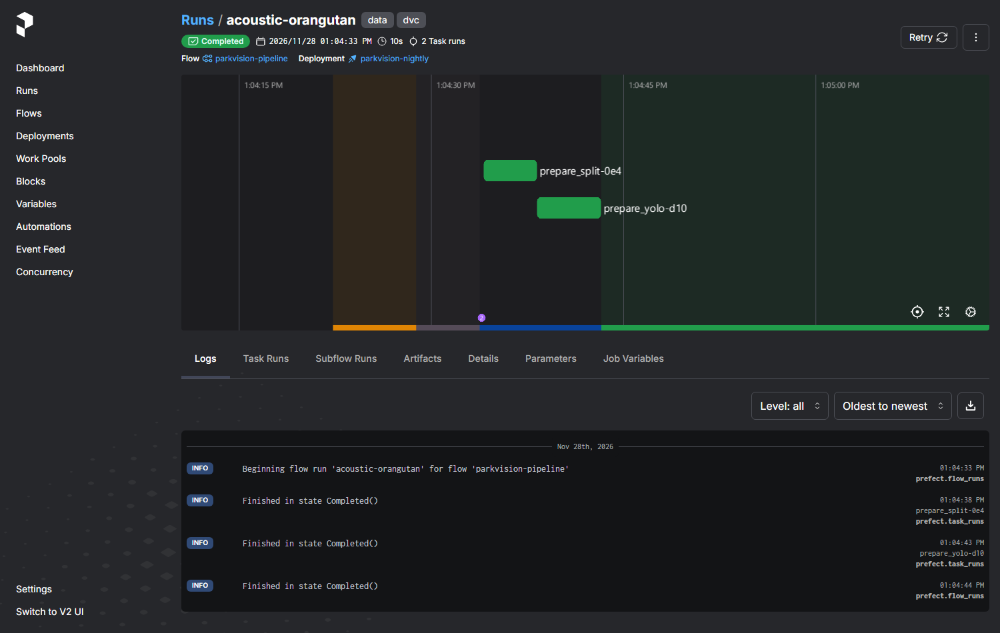
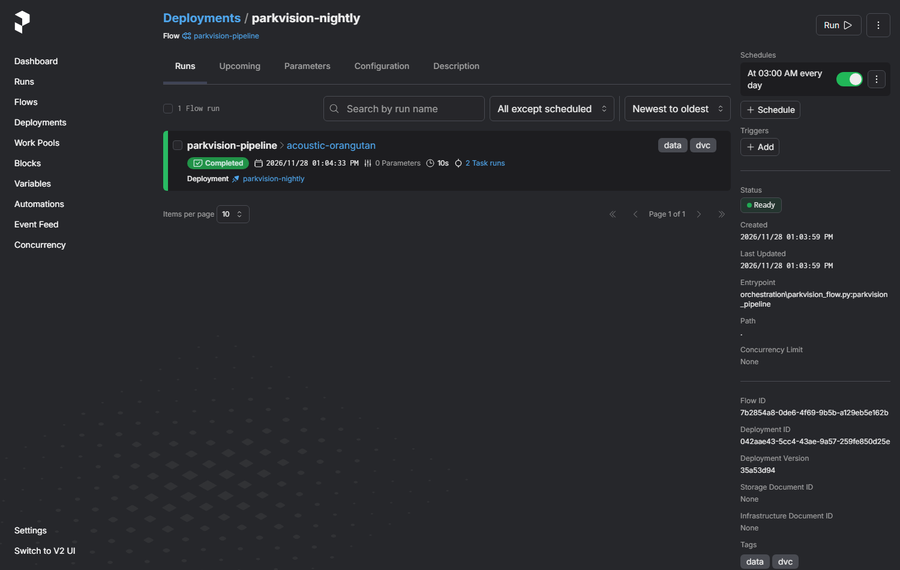

# Orchestration Prefect du pipeline de données

Prefect enchaîne les deux étapes DVC de préparation des données et en garde l'historique
(état, durée, journaux). Ce document suffit à reproduire une exécution réussie sans avoir
jamais utilisé Prefect.

## Ce que fait le flux

Le flux `parkvision-pipeline` ([`orchestration/parkvision_flow.py`](../orchestration/parkvision_flow.py))
contient deux tâches qui s'exécutent l'une après l'autre. Chacune appelle `dvc repro` sur
une étape de [`dvc.yaml`](../dvc.yaml), avec une nouvelle tentative en cas d'échec :

| Tâche | Étape DVC | Produit |
|---|---|---|
| `prepare_split` | `prepare_split` | `data/processed/split_manifest.csv` (découpage par journée) |
| `prepare_yolo` | `prepare_yolo` | `data/processed/yolo/` (images et listes au format YOLO) |

**Limite à connaître : le flux ne prépare que les données.** L'entraînement se fait sur
Colab et ne fait pas partie du flux.

## Préparer l'environnement

Prefect est installé **uniquement** avec les outils d'entraînement, dans un environnement
séparé de celui du backend :

```powershell
pip install -r requirements-training.txt "dvc[s3]"
```

Prefect 3.8.8 exige `fastapi >= 0.139`, alors que le backend et la CI sont épinglés à
`fastapi==0.115.12`. **Ne pas installer Prefect dans l'environnement du backend** (et ne
pas mélanger les deux) : ce conflit est la raison pour laquelle `prefect` est dans
`requirements-training.txt` et pas dans `requirements-serving.txt`. Pour la même raison,
les tests `tests/test_prefect_flow.py` et `tests/test_serve_pipeline.py` sont ignorés dans
la CI, où Prefect n'est pas installé.

Les étapes ont besoin des données : `dvc pull -r dagshub` (extra `dvc[s3]` et identifiants
DagsHub personnels, voir le README). Si `dvc status` répond « Data and pipelines are up to
date », elles sont déjà là.

## Lancer le flux

Deux terminaux, depuis la racine du projet.

**Terminal 1** : le serveur Prefect (à laisser tourner) :

```powershell
prefect server start
```

L'interface est alors sur <http://127.0.0.1:4200>.

**Terminal 2** : pointer vers ce serveur et lancer le flux :

```powershell
$env:PREFECT_API_URL = "http://127.0.0.1:4200/api"
python orchestration/parkvision_flow.py
```

### À quoi ressemble une exécution réussie

Dans le terminal :

```
Flow run 'abiding-flamingo' - Beginning flow run 'abiding-flamingo' for flow 'parkvision-pipeline'
Stage 'prepare_split' didn't change, skipping
Data and pipelines are up to date.
Task run 'prepare_split-aa2' - Finished in state Completed()
Stage 'prepare_yolo' didn't change, skipping
Data and pipelines are up to date.
Task run 'prepare_yolo-3e8' - Finished in state Completed()
Flow run 'abiding-flamingo' - Finished in state Completed()
```

Dans l'interface (*Runs*), l'exécution est **Completed** avec ses deux tâches. La frise
montre `prepare_split` puis `prepare_yolo`, l'une après l'autre :



Exécution lancée à la main (`python orchestration/parkvision_flow.py`) :
[`reports/orchestration/flow_run_manual.png`](../reports/orchestration/flow_run_manual.png).

### « skipped » est un résultat correct

**DVC saute une étape quand ses dépendances et sa commande n'ont pas changé** depuis la
dernière exécution (`dvc.lock`). Un message « didn't change, skipping » n'est donc ni une
erreur ni un échec : les sorties sont déjà à jour. La tâche Prefect finit alors en état
`Completed` en quelques secondes, ce qui est exactement ce que montre la capture ci-dessus
(chaque tâche dure environ 5 secondes).

Les étapes ne se réexécutent réellement que si `data/raw`, le script de l'étape ou
`dvc.lock` changent. Une deuxième exécution immédiate montre donc toujours des étapes
sautées.

## Créer le déploiement

Un flux lancé à la main s'exécute une fois. Un **déploiement** permet de le déclencher à
la demande depuis l'interface ou en ligne de commande, et de le planifier.
[`orchestration/serve_pipeline.py`](../orchestration/serve_pipeline.py) crée le déploiement
`parkvision-nightly` et le sert.

Avec le serveur Prefect démarré (terminal 1) et `PREFECT_API_URL` défini :

```powershell
python orchestration/serve_pipeline.py
```

Le déploiement est planifié **tous les jours à 03:00** (heure de la machine). Variantes :

```powershell
python orchestration/serve_pipeline.py --no-schedule        # déclenchement manuel seulement
python orchestration/serve_pipeline.py --cron "0 6 * * 1"   # tous les lundis à 06:00
```

Ce processus **doit rester ouvert** : il exécute les runs demandés et planifiés. L'arrêter
(Ctrl+C) met le déploiement hors service. Dans un troisième terminal, on déclenche une
exécution à la demande :

```powershell
$env:PYTHONUTF8 = "1"
prefect deployment run "parkvision-pipeline/parkvision-nightly"
```

On peut aussi cliquer sur **Run** dans la page du déploiement. `PYTHONUTF8=1` évite une
erreur d'affichage de la console Windows (`UnicodeEncodeError`) : l'exécution est créée
dans tous les cas.

La page *Deployments* montre le déploiement (planification « At 03:00 AM every day », état
Ready) et ses exécutions :



## Limites connues

- **Seule la préparation des données est orchestrée** : l'entraînement (Colab), la
  validation, l'enregistrement du modèle et son déploiement ne le sont pas.
- **Le déploiement n'est actif que tant que `serve_pipeline.py` tourne**, et la
  planification n'est exécutée que si la machine est allumée à 03:00. Il n'y a ni *work
  pool* ni worker : pour un usage de production, il faudrait un serveur toujours allumé.
- **Le serveur Prefect est local** : son état est dans `~/.prefect` sur chaque machine.
  L'historique n'est pas partagé entre les membres de l'équipe.
- **Pas de notification** en cas d'échec : il faut regarder l'interface.
- **Deux environnements Python** sont nécessaires à cause du conflit `fastapi` décrit plus
  haut.
